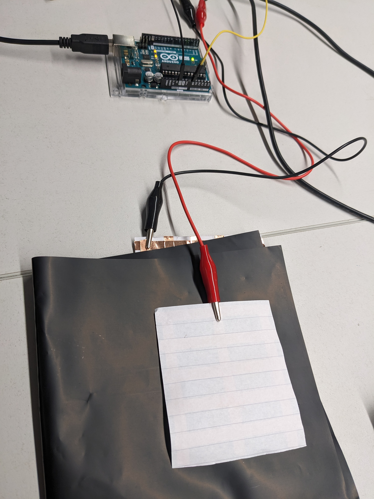
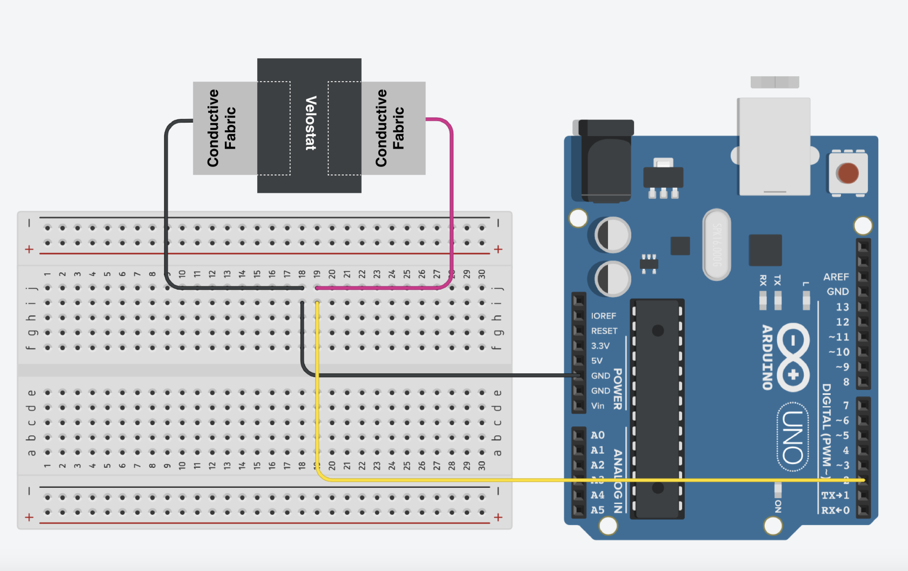
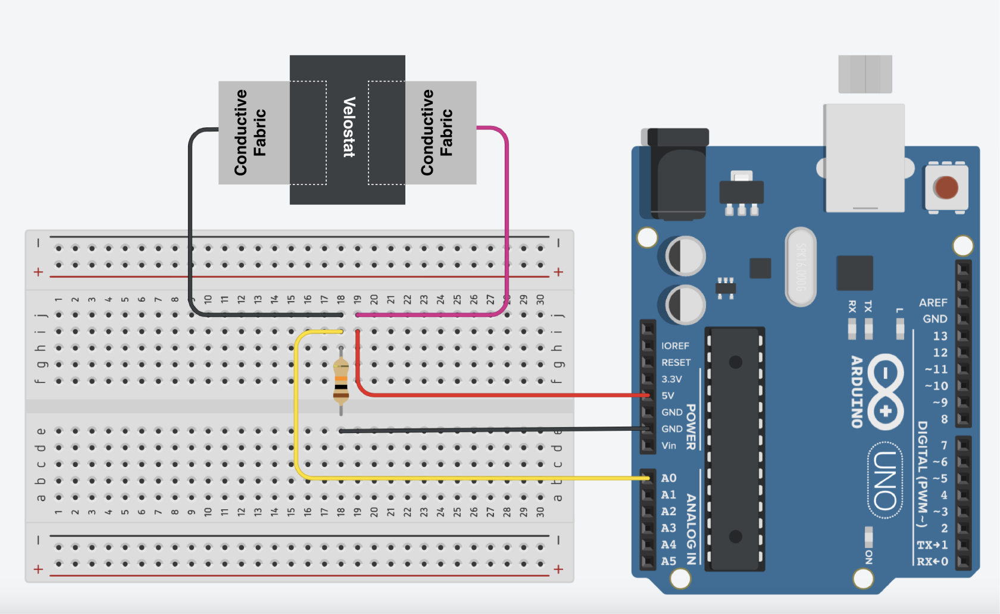

# Velostat

Velostat (a.k.a. Linqstat) is a thin, flexible, pressure-sensitive plastic sheet made with carbon black. It’s a piezoresistive material — its electrical resistance changes when pressure is applied.


----
### HARDWARE

- Velostat

- Copper and paper sheets (included in our hackSpace kit)

- Crocodile Clips

- Arduino Board

- LED

- 220ohms resistor

- 10K resistor

----
### USE CROCODILE CLIPS

For this first prototype, you can use crocodile clips for the connections



----
### BUTTON : WIRING AND CODE

- Wire as follows:



- Upload this code to your Arduino Board
  
```
int buttonPin = 2;
int buttonState;

void setup() {
  // put your setup code here, to run once:
    Serial.begin(9600);
    pinMode(buttonPin, INPUT_PULLUP);

}

void loop() {
  // put your main code here, to run repeatedly:
  buttonState = digitalRead(buttonPin);
  Serial.println(buttonState);

  delay (100); // change for the speed of serial monitor

}
```

----
### ANALOG READINGS: WIRING AND CODE



```
int sensorPin = A0;

void setup() {
  Serial.begin(9600);
}

void loop() {
  
  int sensorValue = analogRead(sensorPin); // gives analog values for the sensors
  Serial.println(sensorValue);

  delay (100); // change for the speed of serial monitor
}
```

----
### DIY SENSOR TIPS / DEBUG

- The two copper pads must never touch each other directly. 

- If your readings barely change when you press, are unstable, or stay near zero, increase the area where copper and velostat overlap. More contact = stronger signal. 


----
### MORE TUTORIALS / EXAMPLES

[Creating Pressure Sensors with Velostat and Conductive Thread](https://www.youtube.com/watch?v=lPxr8RTkFOQ&t=1s)

[Creating Pressure Sensors with Velostat and Conductive Fabric](https://www.youtube.com/watch?time_continue=82&v=8SQOBF0_80Y&embeds_referring_euri=https%3A%2F%2Fwww.bing.com%2F&embeds_referring_origin=https%3A%2F%2Fwww.bing.com&source_ve_path=Mjg2NjY)

[Matrix Keyboard using Velostat](https://www.youtube.com/watch?v=DKAtv-m32v8) 

[Firewalker LED Sneakers](https://learn.adafruit.com/firewalker-led-sneakers)


